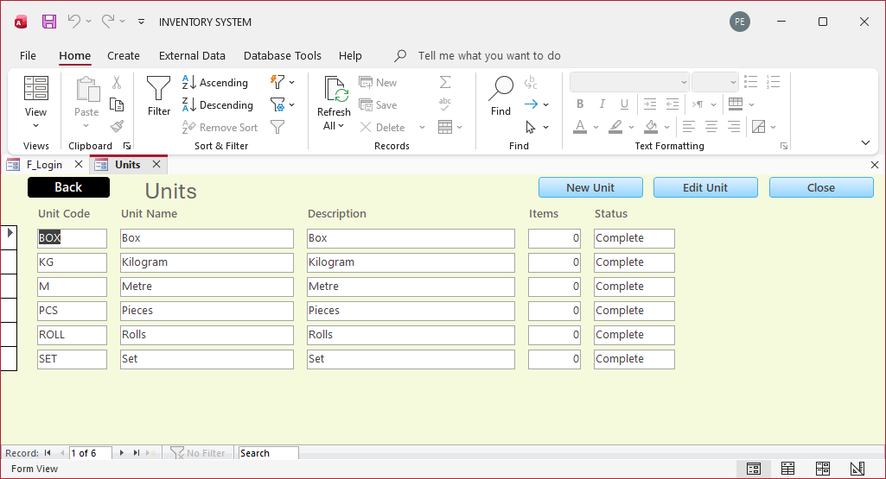
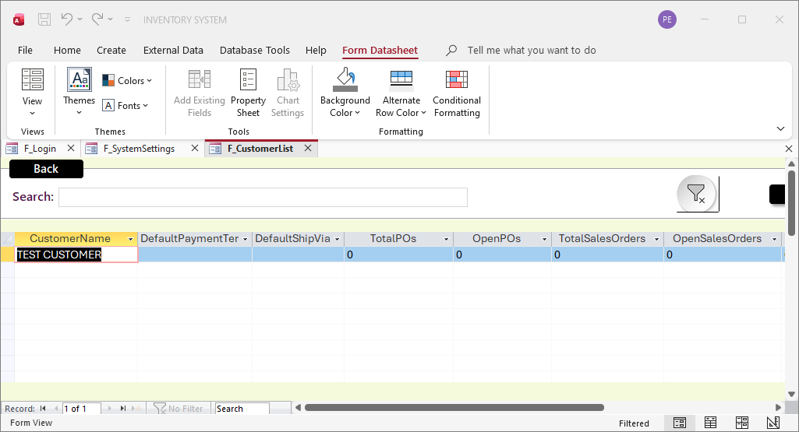
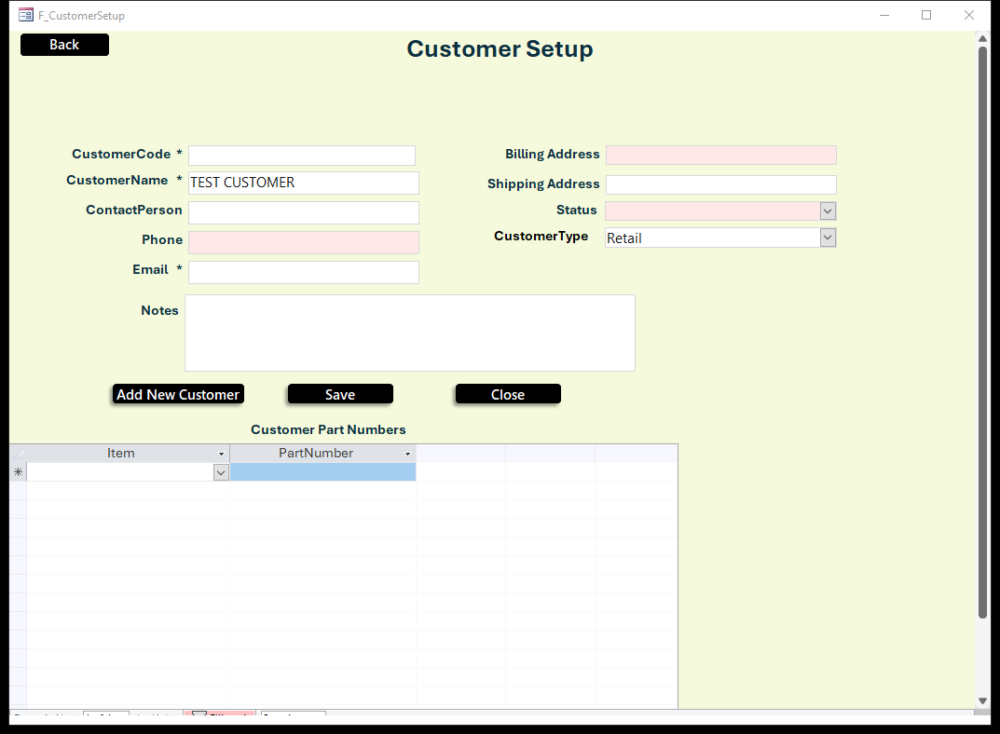

# LLC Inventory System
### Point of Sale + Inventory + ERP — built entirely in Microsoft Access

> **MS ACCESS EDIT WITH AI** — this database was diagnosed, repaired and extended with AI-assisted Microsoft Access engineering.
> Need changes to your own Access system? **[Email me](mailto:karungokihara@gmail.com?subject=MS%20ACCESS%20EDIT%20WITH%20AI%20—%20Support%20Request)** — details at the [bottom](#need-changes-ms-access-edit-with-ai).

---

## Overview

**LLC Inventory System** is a complete, single-file business system for Microsoft Access. It combines a
point-of-sale / sales counter flow with inventory control, purchasing, light manufacturing, projects,
customers, suppliers, HR, expenses and accounting — all inside one `.accdb` file that runs on a normal
Windows PC with Microsoft Access installed.

It is designed for small and medium operations that want one system instead of five spreadsheets:

- One file, one backup, one place for every transaction.
- Offline-first: no internet, no subscription, no external server required.
- Multi-user over a shared folder, with role-based permissions.
- Built to be **edited** — forms, queries and VBA are open, documented and named consistently.

This build (Version One) includes a full pass of bug fixes and enhancements across the unit list,
location setup, warehouse navigation, customer review, backup/restore, draft statuses, assembly
part numbers, dashboard drill-downs and list-form scrolling.

---

## What is in this folder

| File / folder | Purpose |
|---|---|
| **`LLC_v1_2026-10-29.accdb`** | **The working system — open this one.** Version One, compacted and compile-checked. |
| `LLC.accdb` | The original database. Kept untouched for reference. |
| `LLC.accdb.bak` | Older backup of the original database. Keep as an archive. |
| `LLC_v3_2026-10-29.accdb` | Pre-final working build. Useful as a comparison copy. |
| `LLC_v3_before_fixes.accdb` | Safety copy taken before the first round of fixes. |
| `LLC_v3_before_fixes2.accdb` | Safety copy taken before the second round of fixes. |
| `Backups/` | Automatic data backups created by the built-in backup tool. |
| `screenshots/` | Example screens used in this README. |
| `_inspect/` | Reference material produced while the original file was being inspected. Safe to delete. |
| `_work/` | Build scripts, test harnesses and screenshots produced while the system was being repaired. Safe to delete. |

---

## Core capabilities

### Sales / POS counter
- Sales Orders with line items, quantities, pricing and status tracking.
- Invoices and invoice lines, with printable invoice and sales documents.
- Customer Purchase Orders (customer POs, releases and PO lines).
- Quotations, delivery notes and sales-document reports.
- Customer list with search, quick add and a full customer record.

### Inventory and warehousing
- Items with SKU generation, categories, base units, item class and item-level suppliers.
- Multiple warehouses, each with its own locations, bins and shelves.
- Locations can exist **without** a warehouse, and bins/shelves are always optional.
- Stock In, Stock Out, Transfers, Goods Receipts and a full Stock Movement history.
- Live stock balances per item, warehouse and location.
- Low-stock and tool-return notifications.
- Serial-number tracking, manufacturer/vendor/internal part numbers and part-number types.

### Purchasing and suppliers
- Supplier records, supplier items and supplier purchase orders.
- Procurement workspace and a "send PO" flow.
- Purchase order and supplier PO reports.

### Assembly / light manufacturing
- Assembly Templates with materials, tools and work instructions.
- Manufacturer, vendor and internal part numbers per template.
- **Auto Generate Part Number** option with manual override, plus revision-aware numbering.
- Assembly jobs, job materials, job tools and project issue of materials.

### Projects
- Projects linked to customers, finished items, templates and output locations.
- Project issue of materials, project lists and printable project reports.

### Business support modules
- Expenses and expense statistics.
- Accounting workspace.
- HR: staff, leave and attendance.
- Notification Center for low stock and tool returns.
- Statistics screen and 14 ready-made reports (POs, invoices, quotations, delivery notes,
  inventory, projects, warehouse locations, template notes and more).

### Administration and data safety
- Login screen with users, roles and permissions.
- Business Readiness dashboard: totals, incomplete records and ready records for every area
  (customers, suppliers, categories, units, items, templates, warehouses, locations) — each counter
  **drills down** to the matching filtered list.
- Full system **backup** and **restore** from System Settings, including a safety backup before restore.
- Consistent status vocabulary: **Draft / In Review / Pending Approval / Complete**. Drafts are work in
  progress and are never counted as "incomplete".

---

## Built for multitasking

The system is meant to be used by a team, not a single clerk at a single screen:

- **Multiple users** can work in the same database over a shared folder, each with their own login
  and role permissions.
- **Multiple workflows at once** — sales, purchasing, stock movements, assembly, projects,
  HR and expenses live in one file and reference the same master data, so there is no re-typing
  between modules.
- **Multiple warehouses and locations** with independent stock and location-level detail.
- **Multiple projects and assembly jobs** tracked in parallel.
- **One dashboard** that shows the readiness of every area and lets you jump straight into the
  records that need attention.

Access is a desktop database, so "multitasking" here means concurrent users and parallel workflows
within one shared file — not a cloud service. For best results keep the file on a wired network share,
give each user their own Windows session, and avoid opening the same record for editing at the same time.

---

## Quick start

1. **Copy the system to its working location** (a local folder or a shared network folder).
2. Open **`LLC_v1_2026-10-29.accdb`** with Microsoft Access 2013 or newer.
3. If Access shows a security bar, click **Enable Content**.
4. Add the folder to **Trust Center → Trusted Locations** so VBA and the backup tools run without prompts.
5. Sign in on the login screen with the account provided for your site.
6. Set up master data in this order:
   1. Units
   2. Categories / item types
   3. Currencies, warehouses and locations
   4. Items (with base unit, category and default location)
   5. Customers and suppliers
   6. Opening stock (Stock In or Goods Receipt)
7. Open **System Settings** to see the Business Readiness dashboard and review anything marked incomplete.

> Tip: if a startup form blocks you while editing, hold **Shift** while opening the file to bypass
> startup options, or open the file with the login form closed.

---

## Daily workflow (POS and stock)

1. **Sell** — create a Sales Order or an Invoice, pick the customer, add item lines and save.
2. **Issue stock** — Stock Out (or the invoice/sales flow) reduces the balance for the chosen
   warehouse and location.
3. **Receive stock** — Stock In or Goods Receipt increases balances and records the movement.
4. **Buy** — raise a Supplier PO, send it, then receive against it.
5. **Build** — use an Assembly Template to issue materials/tools to a job and record the output.
6. **Review** — use the dashboard, statistics and reports for stock value, sales, purchasing and readiness.

Every movement is written to **Stock Movements**, so the history is always auditable.

---

## Backup and restore

- **Backup:** System Settings → **Backup All Data**. A timestamped `.accdb` is written to the
  `Backups` folder next to the database.
- **Restore:** System Settings → **Restore All Data**. Choose a backup file. The system:
  1. takes a safety backup of the current data first,
  2. clears the current data in a foreign-key-safe order,
  3. imports every table from the backup.
- After a restore, **close and reopen the database** before continuing.

Back up before every structural change, before month-end, and before letting anyone edit the design.

---

## How to edit and customise

The system is deliberately open and consistently named. You can edit it in Access itself, with or
without AI assistance.

### Naming conventions

| Prefix | Meaning | Examples |
|---|---|---|
| `T_` | Tables | `T_Items`, `T_StockMovements`, `T_AssemblyTemplates` |
| `Q_` | Saved queries | `Q_UnitList`, `Q_ItemList` |
| `F_` | Forms (editors and list screens) | `F_ItemSetup`, `F_CustomerList`, `F_SystemSettings` |
| `SF_` | Subforms | `SF_ItemSetupList`, `SF_CustomerPOLines` |
| `R_` | Reports | `R_Invoice`, `R_PurchaseOrder` |
| `M_` | Standard VBA modules | `M_UX`, `M_Fixes`, `M_Backup`, `M_Security` |
| `~sq_...` | Access-generated form recordsources | leave these alone |

### Key VBA modules

| Module | Responsibility |
|---|---|
| `M_UX` | Navigation, layout fitting, login/logout and shared UI helpers. |
| `M_Fixes` | Readiness criteria, status handling, drill-downs, unit list actions, part-number helpers. |
| `M_Backup` | Full backup and restore. |
| `M_Security` | Users, roles and permissions. |
| `M_QuickAdd` | Reusable quick-add behaviour for combo boxes. |
| `M_ItemHelpers` | SKU generation, item lookup and related helpers. |
| `M_Notifications` | Low-stock and tool-return notifications. |
| `M_ProjectIssueSetup` | Project issue staging and posting. |

### Safe editing workflow

1. **Work on a copy** — never experiment on the live file during business hours.
2. Open the copy, hold **Shift** if you need to bypass the startup form.
3. Edit forms and reports in **Design View**, and code in the **Visual Basic Editor** (Alt + F11).
4. Change one thing at a time; keep table and field names stable, or update every query, form and
   report that references them.
5. In the VBA editor choose **Debug → Compile**, then fix anything the compiler reports.
6. Test the affected screen, plus one downstream screen (for example, save an item and then check
   that the item list and the readiness counter updated).
7. **Compact and Repair** the database (Database Tools → Compact and Repair Database) before
   handing it back.
8. Take a backup and note what changed.

### Rules of thumb

- Do not rename tables or delete fields that are referenced by forms, queries, reports or VBA.
- Do not edit the `~sq_` queries; they are generated by Access from form recordsources.
- Keep new status values inside the existing vocabulary (Draft / In Review / Pending Approval / Complete)
  so the readiness counters keep working.
- Keep backups off the same disk as the live file when possible.

---

## Need changes? MS Access Edit with AI

**MS ACCESS EDIT WITH AI** is exactly how this database was repaired and extended: AI-assisted
diagnosis of the Access object model, VBA review, targeted patches, compile checks and regression
tests on scratch copies.

If you want your own Microsoft Access database fixed, extended or modernised, I can help with:

- Bug fixing in forms, queries, reports and VBA.
- New modules, screens and workflows (POS, inventory, purchasing, projects, HR, reporting).
- Backup/restore, login and permission systems.
- Performance clean-up, compacting, and safe refactoring.
- Documentation and a tested copy for every change.

**How it works:** email me what you want changed, with a copy of the database (or a description of
the problem and screenshots). You get a scoped plan, the change is tested on a copy, and you receive
a working file plus notes on what changed. No change is applied to your live data without a backup.

### Contact

**Karungo Kihara**
**Email: [karungokihara@gmail.com](mailto:karungokihara@gmail.com?subject=MS%20ACCESS%20EDIT%20WITH%20AI%20—%20Support%20Request)**

Please put **“MS ACCESS EDIT WITH AI”** in the subject line so your message is easy to find.
Tell me your Access version, what the system does, and what you want fixed or added — I will reply
with the next steps.

> Looking for help with Microsoft Access? Search **MS Access edit with AI** and send me an email.
> I take on fixes, enhancements, new builds and rescue work for existing Access systems.

---

## Screenshots

**Units list** — reachable from the readiness counter, with view/edit/create and complete/incomplete status.

**Customer list** — filtered drill-down from the dashboard counter, with horizontal scrolling restored.

**Customer review** — missing fields are highlighted for quick correction.

---

## Technical notes

- **Platform:** Microsoft Access 2013 or newer on Windows (use the same bitness as the Office install).
- **Storage:** one `.accdb` file; split into front end / back end if the team grows.
- **Multi-user:** shared folder access with per-user logins and role permissions.
- **Customisation:** forms, reports, queries and VBA are editable; no external add-ins are required.
- **Maintenance:** Compact and Repair regularly; keep the `Backups` folder and copy backups off-site.
- **Version:** this README describes `LLC_v1_2026-10-29.accdb` (Version One).

*Microsoft and Microsoft Access are trademarks of Microsoft Corporation. This system is an
independent solution built on Microsoft Access.*
